<p align="center">
  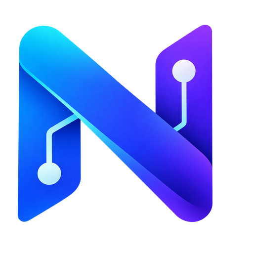
</p>
<h1 align="center">NAVRYNT · Interactive Demo</h1>
<p align="center"><strong>Follow the evidence. Inspect the relationships. Understand the workflow.</strong></p>
<p align="center">A browser-local investigation workspace with a connected fictional case, an interactive graph,<br>illustrative geospatial tracks and a real local file-integrity check.</p>

<p align="center">
  <a href="LICENSE"></a>
  
  
  
</p>
<p align="center">
  <a href="https://kaandevs-ops.github.io/navrynt-demo-public/">Open live demo ↗</a> · <a href="README.tr.md">Türkçe</a> · <a href="#demo">Demo</a> · <a href="#quick-start">Quick start</a> · <a href="#features">Features</a> · <a href="#screenshots">Screenshots</a> · <a href="#scope">Scope</a> · <a href="docs/WORKFLOWS.md">Workflow guide</a>
</p>

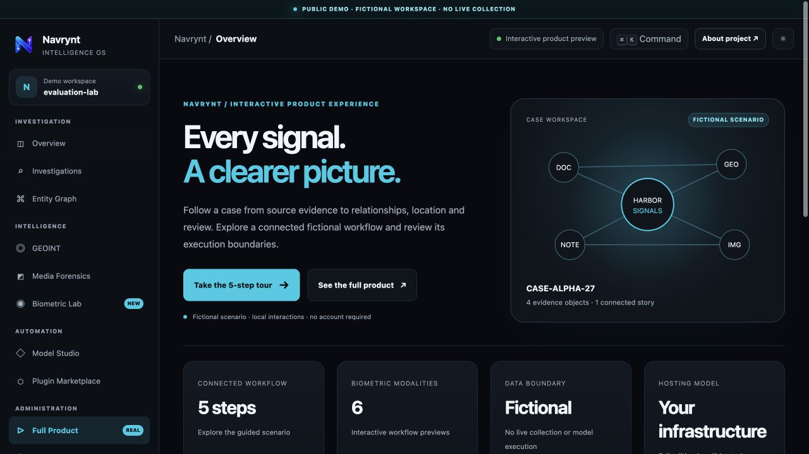

> **Static demo, explicit boundaries.** The interactive case, entities and tracks are fictional. Local file hashing really runs in the browser. Biometric tabs and Model Studio are workflow previews: no model inference, live intelligence collection or training runs here. Open the live demo or run it locally using the commands below. Separate historical full-product recordings are available under Full Product.

## Demo

[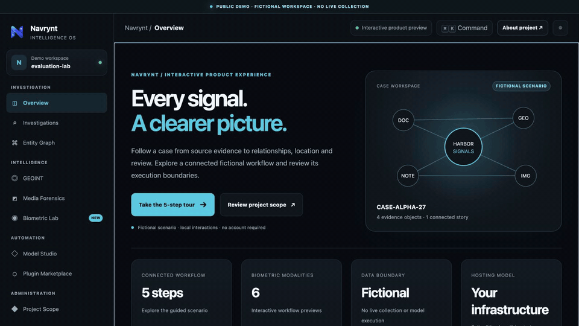](docs/media/demo-walkthrough.mp4)

**[▶ Watch or download the 20-second walkthrough](docs/media/demo-walkthrough.mp4)** · [How to explore the demo](docs/WORKFLOWS.md)

The GIF and silent MP4 use actual screenshots captured while interacting with this repository's demo. Screens are held for readability. The MP4 has eight labelled chapters and is an edited screenshot sequence, not a continuous screen recording. [Capture details and checksums](docs/MEDIA.md).

## Quick start

**No API account, model download, npm installation or build step is required.**

```bash
git clone https://github.com/kaandevs-ops/navrynt-demo-public.git
cd navrynt-demo-public
python3 -m http.server 4173 --bind 127.0.0.1
```

Open **[http://127.0.0.1:4173/](http://127.0.0.1:4173/)** in a current browser. Python 3 is used only to serve static files. Use localhost or HTTPS so Web Crypto can compute file hashes. JavaScript, SVG and native MP4 playback are expected.

Try this path: **Investigations → Harbor Signals → evidence timeline → Entity Graph → GEOINT → Media Forensics**. The toolbar's five-step guided tour also links the main scenario views.

## Features

| Workspace | What you can try | Execution boundary |
|---|---|---|
| **Guided review** | Follow five connected steps through the Harbor Signals scenario | Invented case and evidence |
| **Investigations** | Filter three sample cases, open source details, add a session note and export a JSON brief | Notes reset on reload; export is an example |
| **Entity Graph** | Select six nodes, inspect source context and filter evidence relationships | Illustrative links, not identity findings |
| **GEOINT** | Move a time slider and switch between two tracks | Generated observations; no live tracking |
| **Media Forensics** | Compute SHA-256 for a file up to 20 MiB | Actual local byte hashing; no upload |
| **Biometric Lab** | Explore six modalities and workflow stages | Interface previews; no sample collection or inference |
| **Model Studio** | Configure and download an example run plan | JSON explicitly declares `executes: false` |
| **Connectors** | Review example integration contracts and access requirements | No provider query, installation or permission request |
| **Project Scope** | Inspect the data, execution and licensing boundaries | Full application services are separate |

### One connected investigation

`CASE-ALPHA-27 / Harbor Signals` connects a delivery manifest, generated movement observation, warehouse illustration and analyst review. Inspect where an item came from before following its relationships. A connection in the graph is an investigative illustration, not a conclusion about a real person.

### Six specialist workflow previews

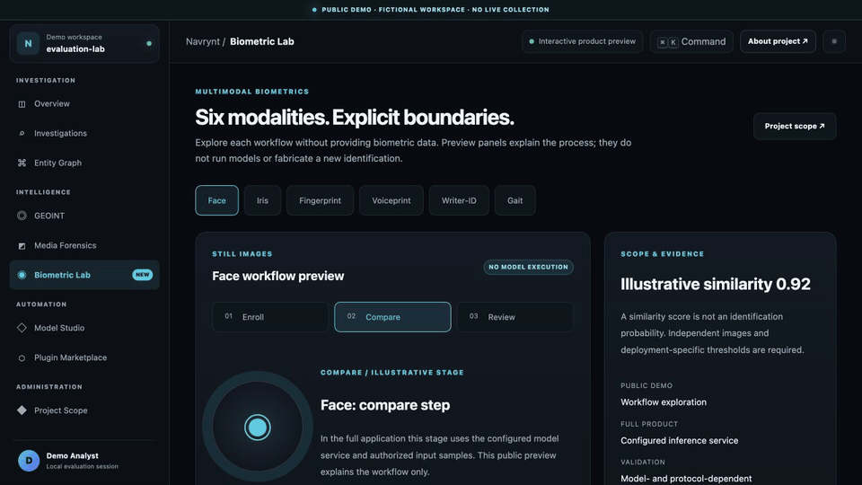

**Face · Iris · Fingerprint · Voiceprint · Writer-ID · Gait** each has a dedicated preview. Stages and boundary notes explain the workflow without requesting biometric data. Illustrative scores and descriptions do not constitute a new identification result or a deployment accuracy benchmark.

## About the full NAVRYNT application

NAVRYNT is a separate self-hosted investigation application with a Python backend and React workspace. It brings together evidence review, relationship graphs, geospatial views, provider adapters, six biometric service paths and supported model lifecycle operations. Installation, model dependencies and provider access are configured separately.

**[Explore the full-product section](https://kaandevs-ops.github.io/navrynt-demo-public/#proof)** · [Recording sources and limits](docs/FULL-PRODUCT.md) · [Watch the 24-second product tour](assets/proof/product-tour.mp4)

| This public demo | Separate full application |
|---|---|
| Fictional cases, selectable SVG graph and generated tracks | Configured investigation workflows and data adapters |
| Six biometric interface previews | Separate model services with protocol-specific evaluation |
| Example plan with `executes: false` | Supported jobs with required models, data and runtimes |
| Browser-local interactions without a backend | Self-hosted backend/frontend and separately configured providers |

### Actual full-product captures

These four historical runs were captured on **16 October 2026**. They are separate from the fictional demo. Playing a clip does not execute that workflow in the browser.

| Regional aircraft exploration | Earthquake map |
|---|---|
| [](assets/proof/aircraft.mp4) | [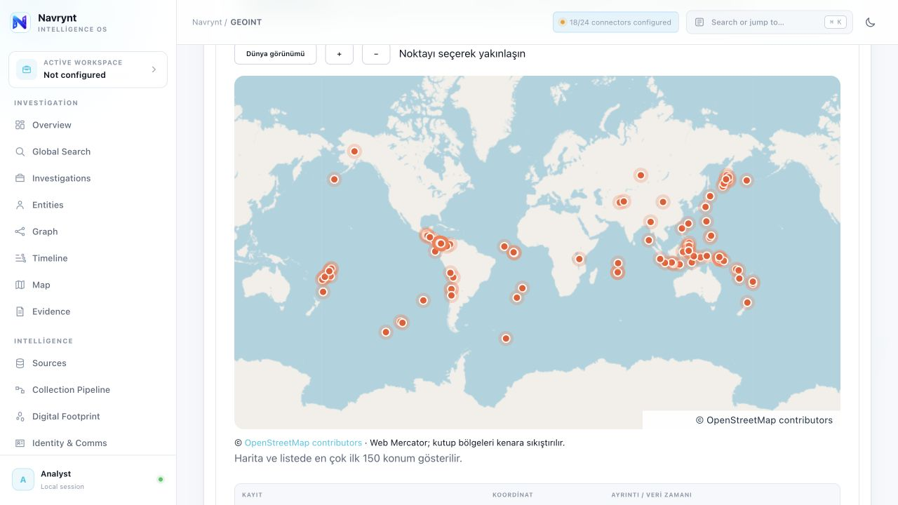](assets/proof/earthquakes.mp4) |

| Company relationship review | Research voice comparison |
|---|---|
| [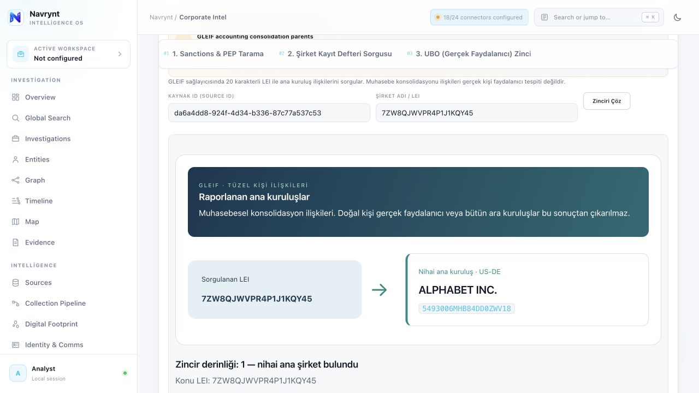](assets/proof/companies.mp4) | [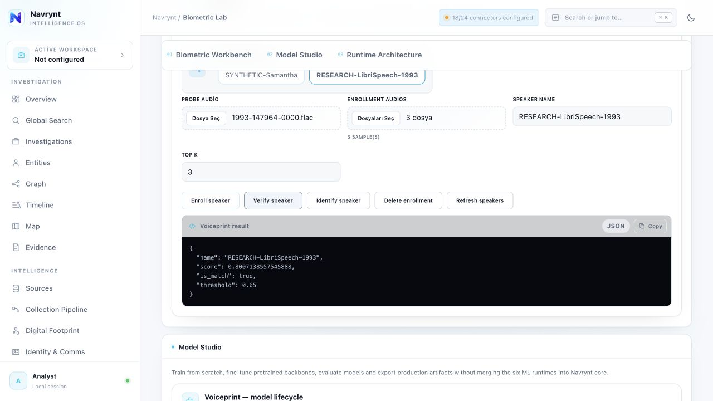](assets/proof/voice.mp4) |

Sources: ADSB.lol/OpenStreetMap, USGS/OpenStreetMap, GLEIF and LibriSpeech. Aircraft data is a historical snapshot; company parentage is an accounting relationship; the voice example is research evidence, not general identity accuracy. These clips do not establish that every provider, biometric service or deployment combination works. [Full attribution and limitations](docs/FULL-PRODUCT.md).

## Screenshots

| Case review and source context | Selectable relationship graph |
|---|---|
| 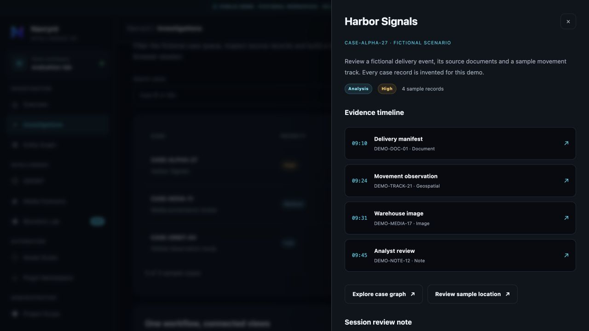 | 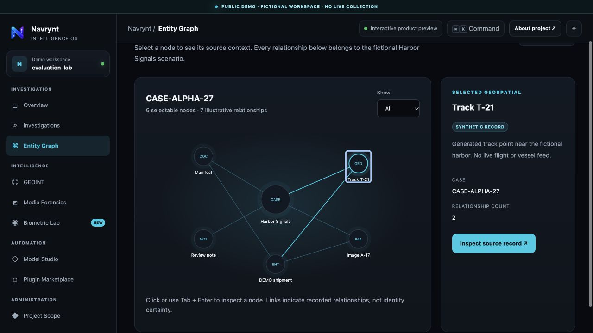 |

| Generated movement observations | Real browser-local SHA-256 |
|---|---|
| 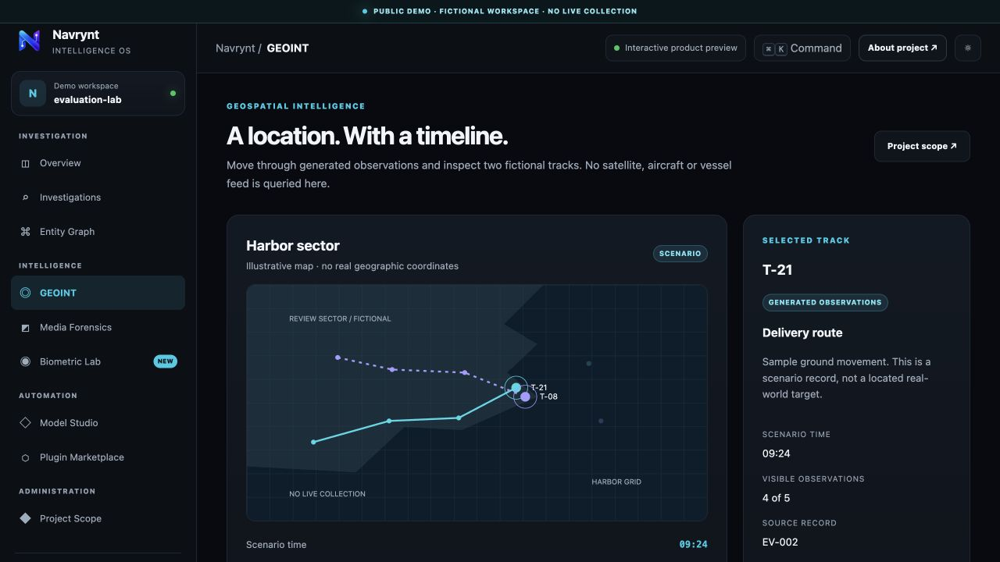 | 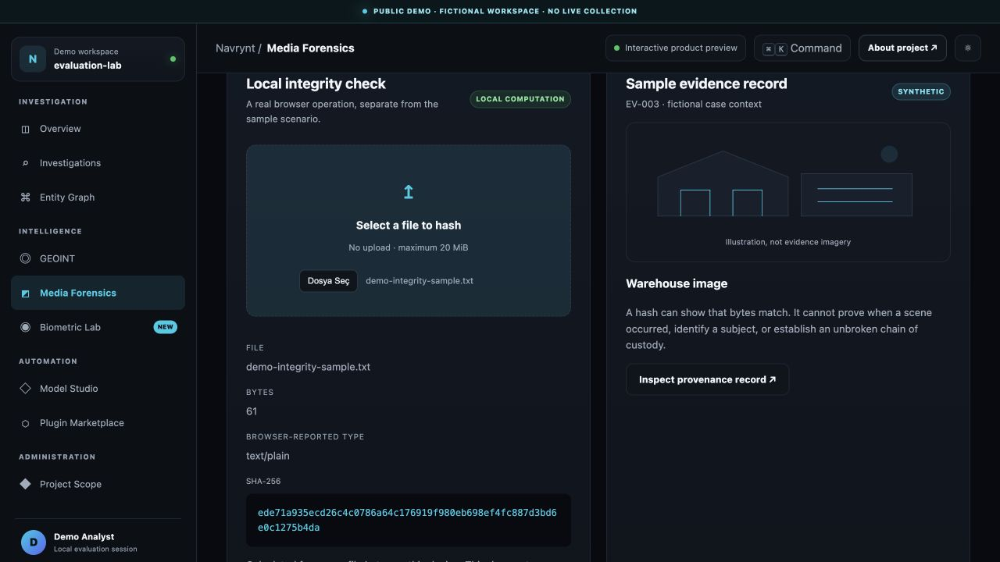 |

| Example model plan | Light theme |
|---|---|
| 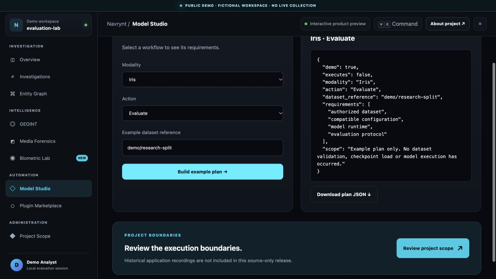 | 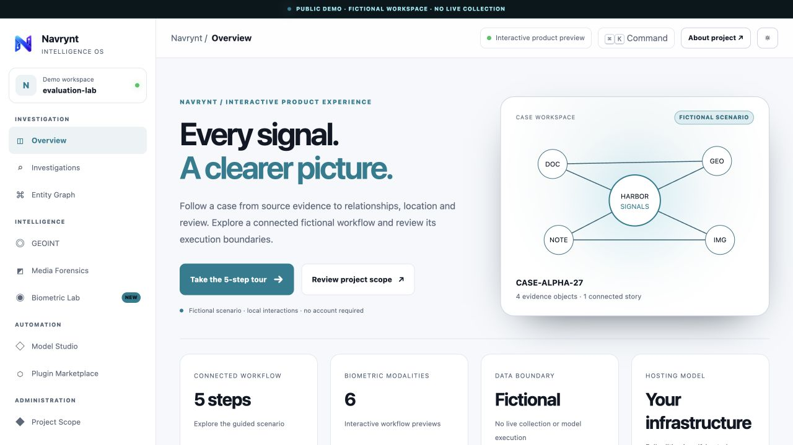 |

<details>
<summary><strong>Mobile layout and individual biometric previews</strong></summary>

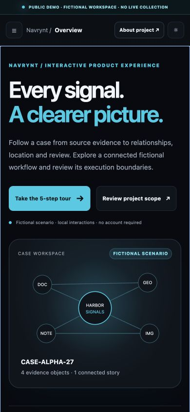

| Face | Iris |
|---|---|
| 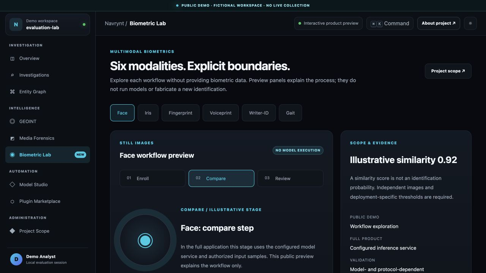 | 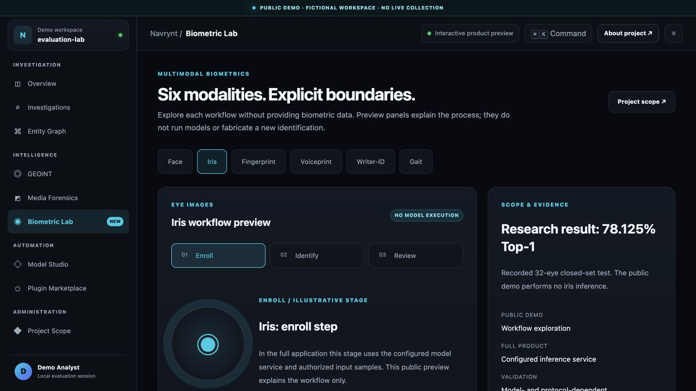 |

| Fingerprint | Voiceprint |
|---|---|
| 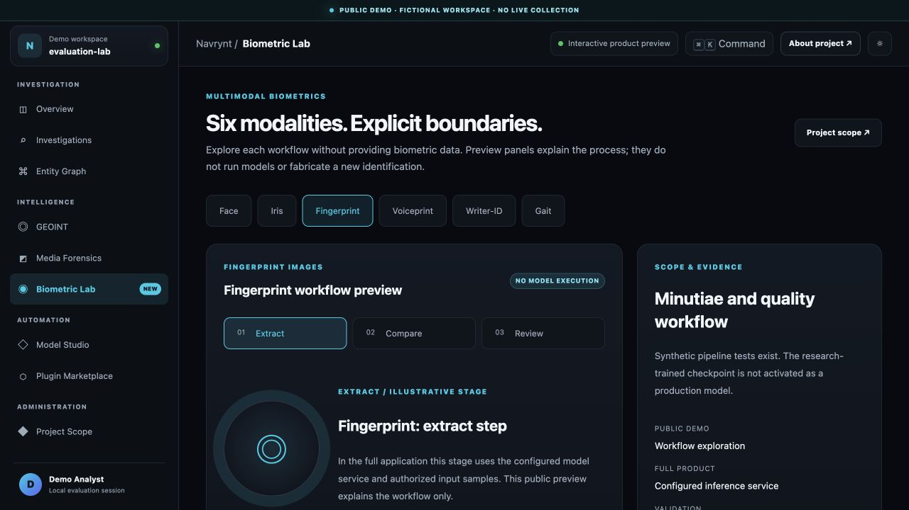 | 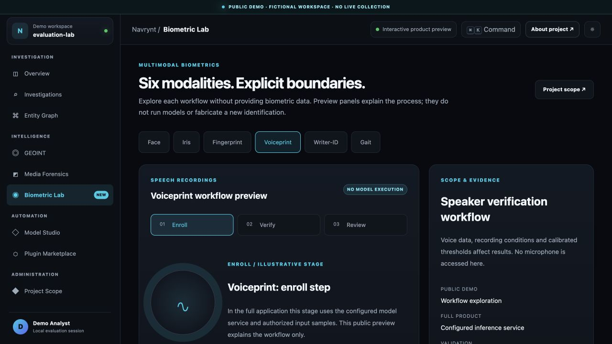 |

| Writer-ID | Gait |
|---|---|
| 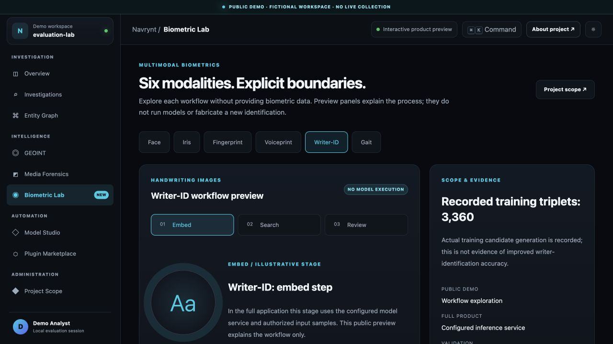 | 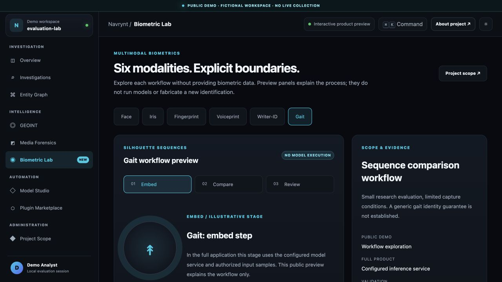 |

</details>

## Controls and accessibility

- Navigate with the sidebar or **Command/Ctrl + K** command palette.
- Use **Tab + Enter/Space** to inspect graph nodes.
- Close drawers and dialogs with **Escape**; focus returns to the opener.
- Switch dark/light themes from the toolbar. The theme preference is stored locally.
- Use the navigation toggle on narrow screens. Reduced-motion preferences are respected.

## Scope

| Runs in this repository | Requires the separate full application |
|---|---|
| Fictional case review and local notes | Live OSINT/provider queries and configured access |
| SVG graph selection and generated map tracks | Real-world location collection and external map/data services |
| Web Crypto SHA-256 of a selected file | Biometric model execution and identity galleries |
| Example brief and non-executing model-plan exports | Model loading, training, evaluation and artifact export |

A matching hash proves byte equality, not authenticity. A graph link does not prove identity. Workflow previews do not establish biometric accuracy or production readiness. The private full application, licensing tools, credentials, model weights and research datasets are not distributed here. Four historical full-product recordings and their source notes are included separately from the fictional demo interactions.

## Technology and structure

Plain **HTML, CSS, JavaScript and SVG**, with **Web Crypto** for hashing. No runtime package dependencies or application backend.

```text
index.html          Entry, navigation and dialog structure
app.js              Fictional scenario and browser-local interactions
scope-view.js       Data and execution boundaries
styles.css          Responsive interface and dark/light themes
assets/             Logo and favicon
docs/WORKFLOWS.md   Hands-on walkthrough and troubleshooting
docs/MEDIA.md       Demo capture method and media checksums
docs/FULL-PRODUCT.md Full-application evidence, sources and limits
assets/proof/       Historical full-product clips, screenshots and captions
docs/media/         Actual demo screenshots, GIFs and edited video
scripts/            Static-file validation helpers
LICENSE             Apache License 2.0
```

## Validation

```bash
python3 scripts/validate.py
```

The standard-library validator checks local file links, HTML IDs, image alt attributes, publication boundaries and JavaScript syntax when Node.js is available. Node.js is optional for running the demo. The recorded walkthrough covers actual UI interactions; it is not a comprehensive automated accessibility or production test suite. GitHub Pages serves the static project from `main` with `.nojekyll`; no application backend is deployed. A separate validation workflow checks files and media integrity on pushes and pull requests. [Hosting details](docs/DEPLOYMENT.md).

## Feedback and license

[Report a reproducible issue](https://github.com/kaandevs-ops/navrynt-demo-public/issues). Include the browser, viewport, steps and expected behavior; keep credentials and personal data out of reports. Changes should preserve the fictional-data boundary and clearly label any example output.

Licensed under **[Apache License 2.0](LICENSE)**. Maintained by **[kaandevs-ops](https://github.com/kaandevs-ops)**.
